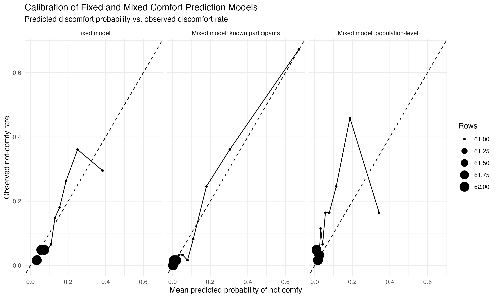
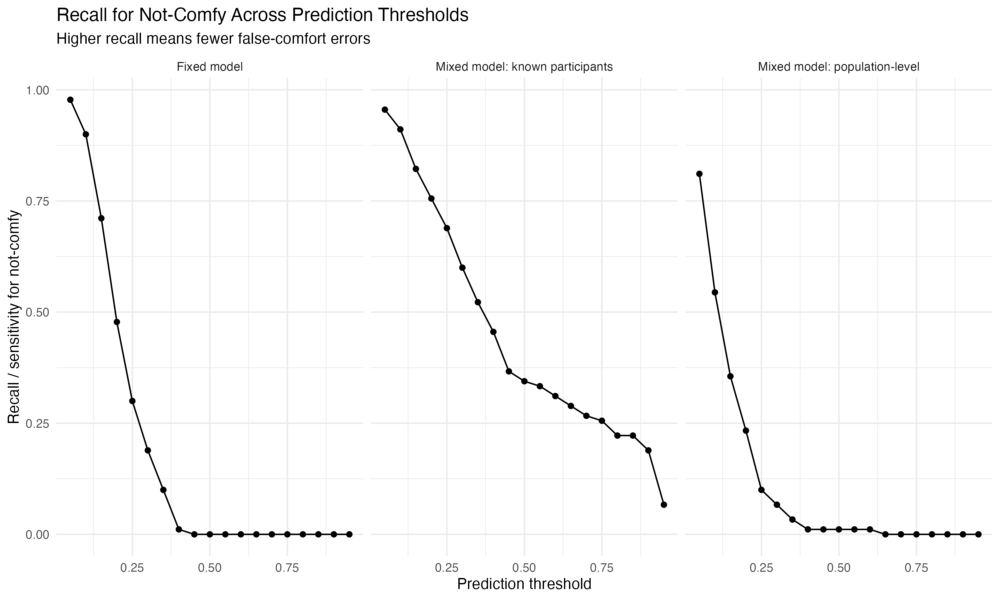
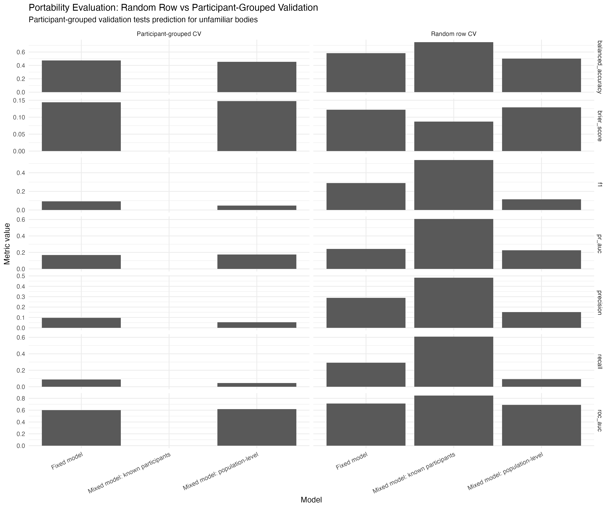

# Comfort Mismatch: Technofragility and the Measured Body

An R analysis of whether wearable sensor measurements can predict reported thermal comfort across people and time. The project compares models with shared coefficients and participant-specific baselines, then tests how they fare when an entire participant is held out.

## Question and approach

The analysis uses 5-minute pre-survey sensor summaries and a binary self-report of being “not comfy.” It examines near-body temperature, humidity, VOC and NOx readings, a skin temperature proxy, location, and local hour. The model-ready table contains 613 observations from 19 participants, including 90 not-comfy reports (14.7%). A report of “not comfy” is a survey outcome, not a complete measure of subjective comfort.

The R scripts cover fixed and mixed logistic models, calibration and threshold checks, repeated random-row validation, leave-one-participant-out validation, a participant sensitivity check, temporal modeling, and within-person sensor deviations.

## Selected results

| Comparison | ROC-AUC | PR-AUC | Brier score |
| --- | ---: | ---: | ---: |
| Fixed model, fitted sample | 0.747 | 0.266 | 0.118 |
| Mixed model, known participants, fitted sample | 0.898 | 0.684 | 0.077 |
| Fixed model, participant-grouped validation | 0.602 | 0.168 | 0.144 |
| Mixed model, population prediction for held-out participants | 0.619 | 0.176 | 0.148 |

These rows describe different evaluation settings. The known-participant mixed result is **in sample** and benefits from participant-specific estimates; it is not an estimate of performance for a new participant. In participant-grouped validation, all observations for one participant are held out at a time. The random-row validation uses 5 folds repeated 20 times, so its 12,260 prediction rows are repeated assessments of the same 613 observations, not new independent participants. Some grouped mixed fits produced convergence warnings. With 19 participants and uneven event counts, these metrics are exploratory.

At a 0.50 threshold, the fixed model classified all 90 not-comfy observations as comfortable in the fitted sample. This shows why the error type and chosen threshold matter alongside discrimination metrics. [Aggregate mismatch counts](results/mismatch_summary_threshold_05.csv) and [validation metrics](results/portability_metrics_summary.csv) are included for inspection.







The figures are generated from the project analysis package. The tables under `results/` are selected aggregate outputs from that package, not newly recalculated numbers in this curated copy.

## Repository contents

- `scripts/00`–`07`: original R analysis scripts, in run order.
- `results/`: selected aggregate tables, including the [sample summary](results/model_df_sanity_summary.csv) and [fitted-sample metrics](results/auc_pr_auc_fixed_vs_mixed.csv).
- `figures/`: three corresponding figures.
- `DATA.md`: analytic input, provenance, and release boundary.

The scripts assume the repository root is the R working directory. `00_setup_packages.R` installs missing packages (`tidyverse`, `lme4`, `performance`, `broom.mixed`, `ggeffects`, `yardstick`, `readr`, `janitor`, `scales`) and loads them. Review it before running; package installation requires an R repository and network access.

If you have authorized access to the original model-ready table, place it at `audit_v2_primary_model_table.csv` in the repository root. Then, from that root, run:

```sh
Rscript scripts/00_setup_packages.R
Rscript scripts/01_load_and_prepare_primary_model_table.R
Rscript scripts/02_mixed_model_calibration_mismatch.R
Rscript scripts/03_threshold_sensitivity.R
Rscript scripts/04_portability_validation.R
Rscript scripts/05_sensitivity_pid29.R
Rscript scripts/06_temporal_modeling.R
Rscript scripts/07_within_between_decomposition.R
```

The scripts write detailed results into ignored output folders. **This public-facing bundle does not include the model-ready table.** It can be inspected as a methods and results portfolio, but it cannot be rerun without that table. The upstream process that joined raw sensor and survey data into the table is also outside the included code. See [DATA.md](DATA.md).

## Interpretation

The analysis suggests that participant familiarity and person-relative sensing matter, while prediction for unfamiliar participants is much weaker. It is an exploratory study of model behavior, not a deployed comfort classifier or a claim that wearables can measure subjective experience universally.
